

 

## About

**레지스터 설정 한 줄이 실제 기구의 움직임으로 이어지는 펌웨어를 만듭니다.**
데이터시트에서 원인을 좁히고, 서보 돌입전류나 센서 튐 값 같은 하드웨어의 물리적 한계를 펌웨어 설계로 다룹니다.

| | |
|---|---|
| **Education** | 한국공학대학교 컴퓨터공학전공 · 2027.02 졸업예정 |
| **Training** | 시스템 반도체 SW 설계 과정 · 대한상공회의소 서울기술교육센터 (2026.05 ~ 2026.12) |
| **Awards** | 캡스톤디자인 경진대회 우수상 (2025.12) · IR 챌린지 모의 발표회 우수상 (2024.09) |
| **Focus** | MCU 펌웨어 · 임베디드 리눅스 디바이스 드라이버 · FPGA |

 

## Tech Stack

**Embedded & Systems** 
        

**Backend** 
   

**DevOps & Tools** 
    

 

## Projects

| | Project | Platform | Role | Keywords |
|:-:|---|---|---|---|
| 01 | [**Smart Recycling Kiosk**](#p01) AI 분리수거 키오스크 분류 기구 펌웨어 | STM32F411 | MCU 펌웨어 전담 · 4인 | Bare-metal C, TIM PWM, USART IRQ |
| 02 | [**Linux Device Driver**](#p02) Jetson 커널 캐릭터 디바이스 드라이버 | Jetson Orin Nano | LED Bar 드라이버 · 4인 | Kernel Module, GPIO, ioctl |
| 03 | [**Smart Gate**](#p03) 로컬 LLM 연동 차단봉 · 신호등 | NUCLEO-F411RE | 펌웨어 · GUI 개편 · 4인 | STM32 HAL, FSM, PyQt5 |
| 04 | [**FPGA Microwave**](#p04) Verilog 전자레인지 컨트롤러 | Basys3 (Artix-7) | 개인 | Verilog, FSM, Testbench |
| 05 | [**Autonomous RC Car**](#p05) 3채널 초음파 자율주행 | ATmega128A | 개인 | AVR, Timer PWM, INT |
| 06 | [**YOLO RPS Game**](#p06) 가위바위보 2인 판정 | PC · TensorRT | 개인 | YOLO11n, ONNX, TensorRT |
| 07 | [**AgeApt**](#p07) 연령 반응형 영화관 키오스크 · 캡스톤 우수상 | AWS EC2 | 백엔드 · 배포 · 4인 | Spring Boot, MySQL, Docker |

 

---

## 01. Smart Recycling Kiosk
**AI 분리수거 키오스크 — 분류 기구 MCU 펌웨어**

 

  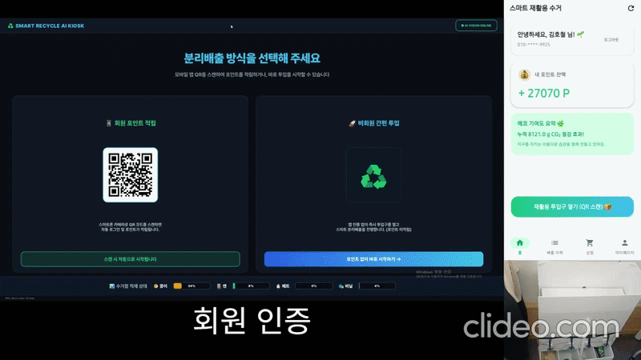

 

| Period | Team | Role | Environment |
|:-:|:-:|:-:|:-:|
| 2026.09 | 4인 | **MCU 제어 · 적재율 필터링** (`mcu_firmware/` 전체) | STM32F411 · arm-none-eabi-gcc · Makefile |

### Overview
Jetson이 카메라 영상으로 재질(종이 · 캔 · PET · 비닐)과 라벨 · 오염 여부를 판별해 UART로 명령을 보내면, STM32가 **서보 3축으로 분류 통로를 맞춘 뒤 투입구를 열고**, 초음파 4채널로 **수거함별 적재율을 계측해 보고**합니다. 저는 이 중 STM32 펌웨어 전체를 HAL 없이 레지스터 수준으로 작성했습니다.

 

  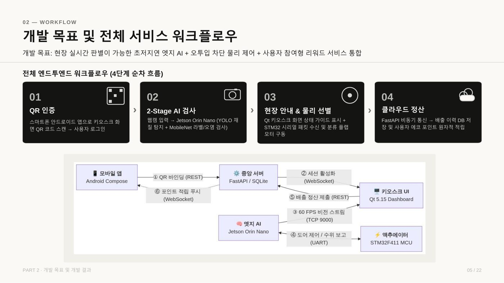
   전체 서비스 흐름 — QR 인증 → Jetson 검사 → <b>STM32 물리 분류</b> → 앱 정산

 

### Key Implementation

| 영역 | 구현 내용 |
|---|---|
| **Bare-metal 환경** | 스타트업 코드(`crt0.s`) · 링커 스크립트 · Makefile 직접 구성, HSI 16MHz → PLL 96MHz, SysTick 1ms |
| **통신** | USART2 RX 인터럽트로 Jetson 명령 수신, USART1은 디버그 로그 전용으로 분리, 상태 변화 시에만 응답 송신 |
| **서보 구동** | TIM3 3채널 50Hz PWM(0.5~2.5ms), 각도 램프 120°/s로 속도 제한 |
| **초음파 계측** | TIM4 1µs 카운터로 에코 폭 측정, 4채널 순차 측정 · 에코 대기 타임아웃 |
| **적재율 필터** | 2초 블랭킹 → 5샘플 중앙값 ±5cm 이탈값 제외 평균 → 5%p 이상 변화 시에만 갱신 |

### Troubleshooting

| Problem | Cause | Solution |
|---|---|---|
| 통로가 맞기 전에 물체가 떨어짐 | 도어와 분류판이 동시에 구동 | **순차 인터록** — 하단 2축 도착(`Servo_Is_Moving()`) 확인 후 상단 도어 개방 |
| 급격한 회전으로 기구 파손 | 서보를 최대 속도로 구동 | 소프트웨어 **각도 램프**로 회전 속도 제한 |
| 부팅 직후 보드 불안정 | 서보 3개 동시 구동 → 돌입전류로 5V 강하 | 시간차를 두고 **한 축씩 순차 정렬** |
| 적재율 수치가 계속 흔들림 | 낙하 중인 물체 · 순간 튐 값 | **3단계 필터**와 변화 임계값 갱신 |

### Gallery

 

<table>
  <tr>
    <td width="38%" align="center">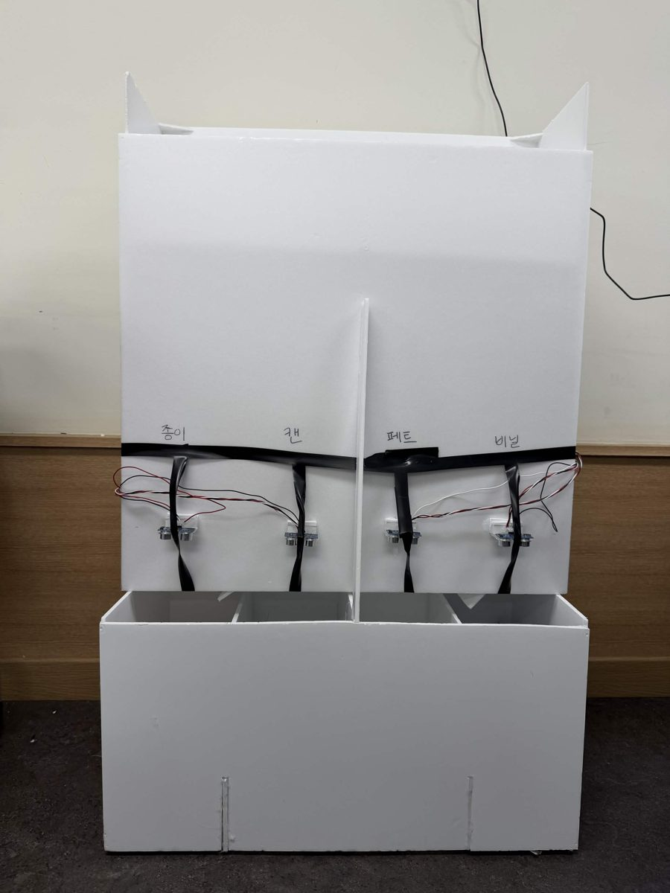  3축 분류 기구 · 4구역 수거함</td>
    <td width="62%" align="center">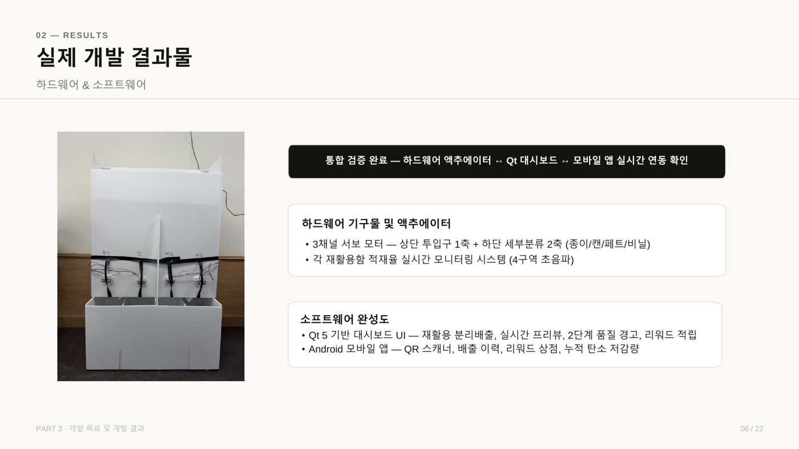  하드웨어 결과물</td>
  </tr>
</table>

 

<table>
  <tr>
    <td width="33%" align="center">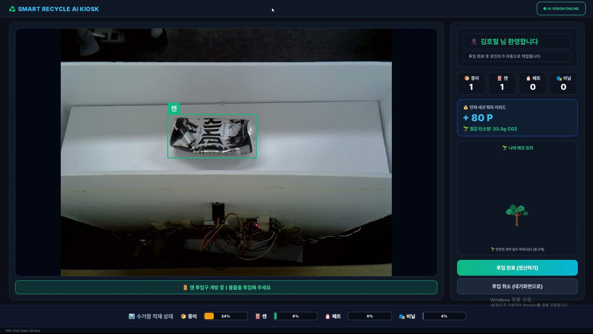  정상 판정 → 분류 · 개방</td>
    <td width="33%" align="center">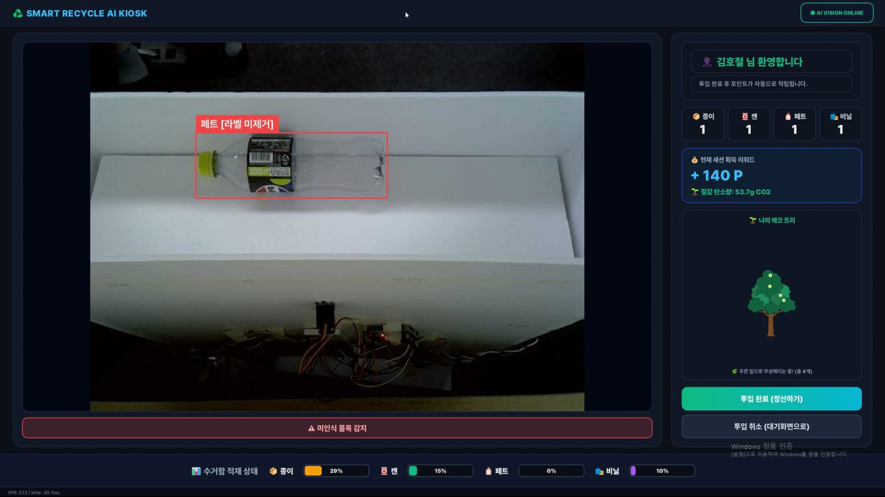  라벨 미제거 → 개방 차단</td>
    <td width="33%" align="center">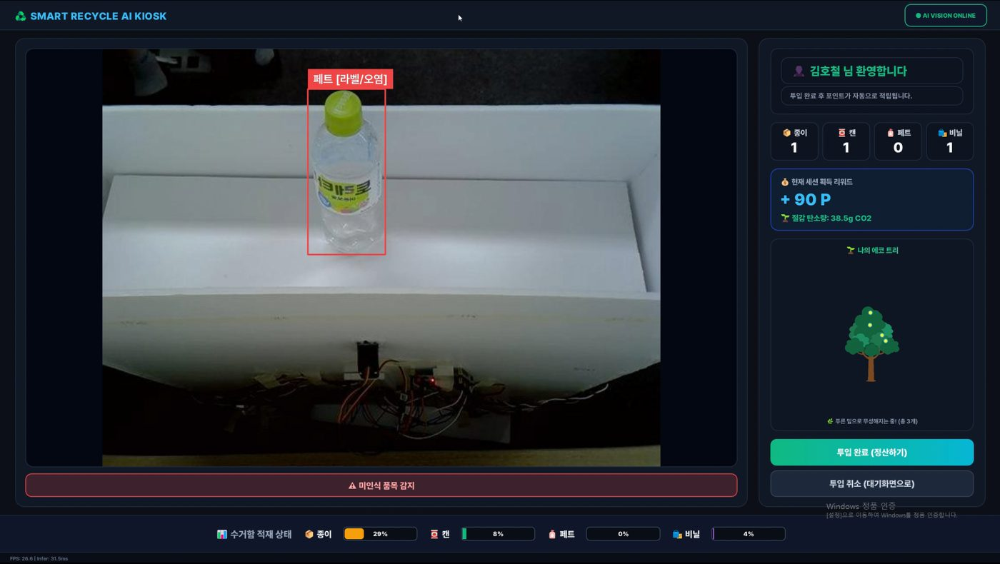  내용물 오염 → 개방 차단</td>
  </tr>
</table>

 

  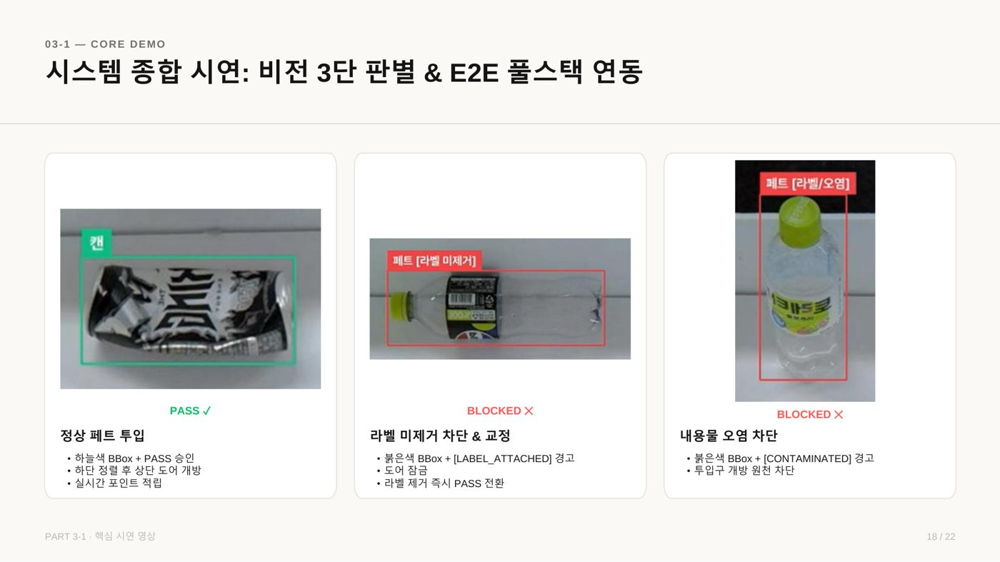
   비전 3단 판별과 하드웨어 연동 시연

 

<table>
  <tr>
    <td width="20%" align="center">  홈</td>
    <td width="20%" align="center">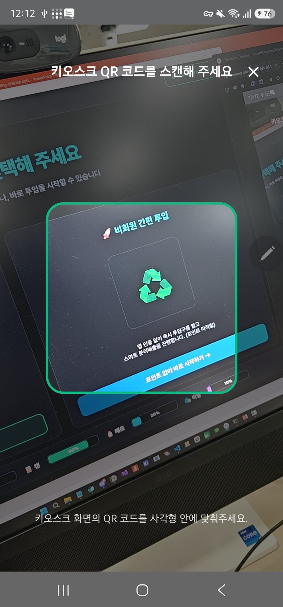  QR 스캔</td>
    <td width="20%" align="center">  키오스크 연결</td>
    <td width="20%" align="center">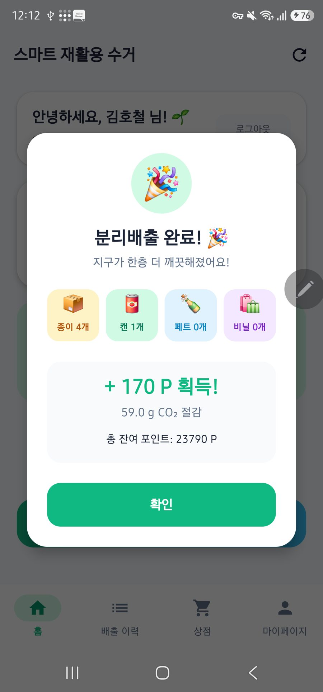  배출 완료</td>
    <td width="20%" align="center">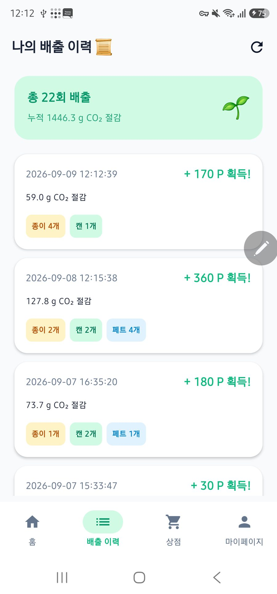  이력 조회</td>
  </tr>
</table>

 

<table>
  <tr>
    <td width="50%" align="center">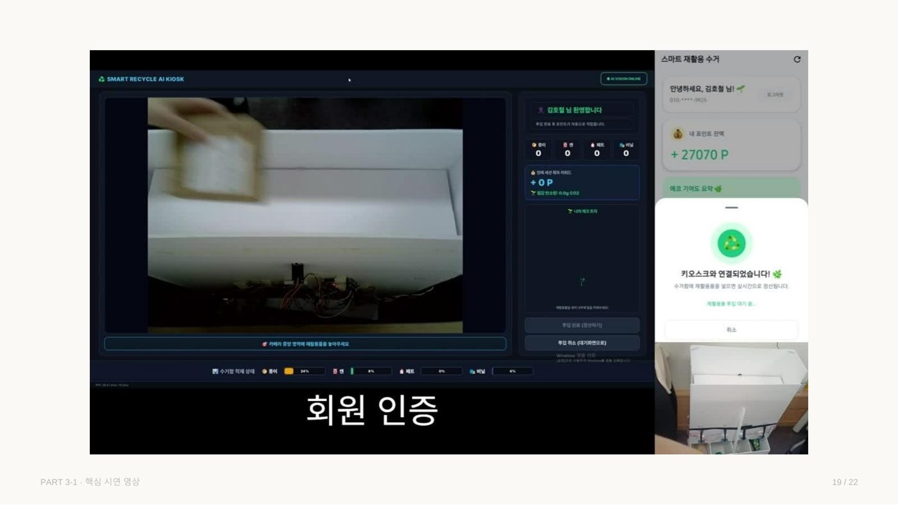  회원 QR 인증 후 투입 결과가 앱에 반영</td>
    <td width="50%" align="center">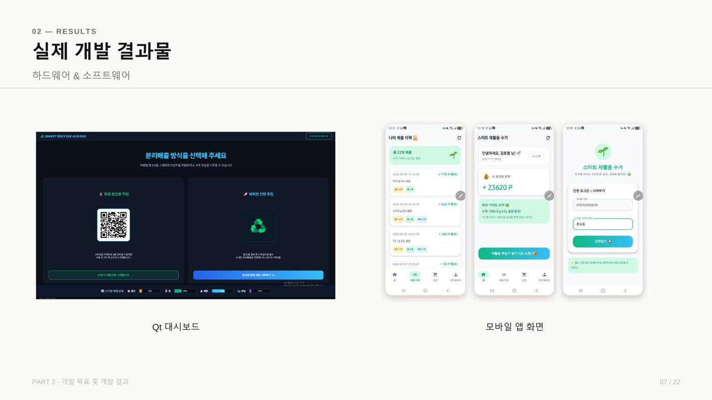  Qt 대시보드 · Android 앱 (팀원 담당)</td>
  </tr>
</table>

 

  <a href="./projects/01_smart-recycling-mcu"><b>Source Code</b></a> &nbsp;·&nbsp;
  <a href="./projects/01_smart-recycling-mcu/mcu_firmware/README.md">MCU Firmware Detail</a>

 

---

## 02. Linux Device Driver
**Jetson Orin Nano 커널 캐릭터 디바이스 드라이버**

 

<table>
  <tr>
    <td width="50%" align="center">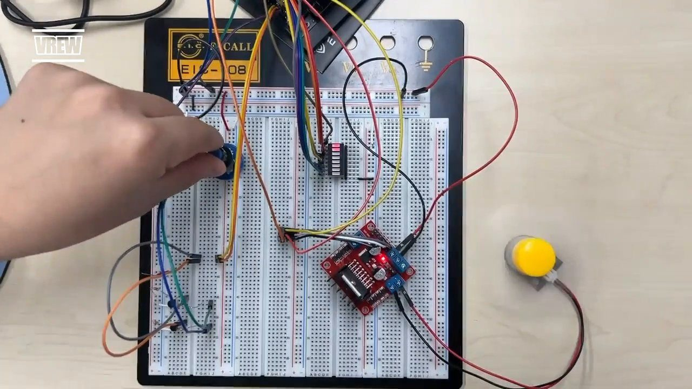  엔코더 회전 → 모터 속도 · LED 레벨 연동</td>
    <td width="50%" align="center">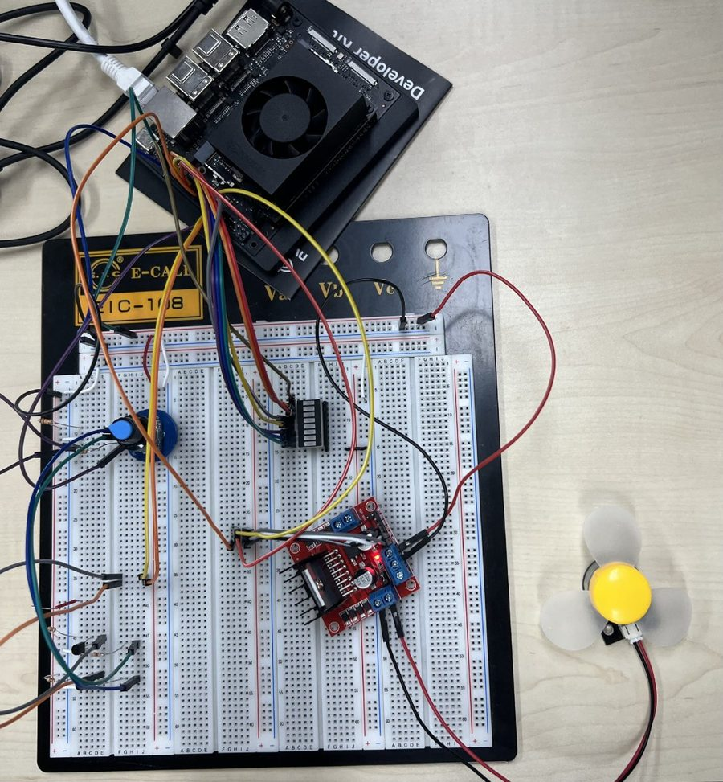  Jetson + EC11 + L298N + 8-Bar LED</td>
  </tr>
</table>

 

| Period | Team | Role | Environment |
|:-:|:-:|:-:|:-:|
| 2026.10 | 4인 | **8-Bar LED 드라이버** (`led_bar_driver.ko`) | Jetson Orin Nano · Linux 5.15-tegra |

### Overview
EC11 엔코더를 돌리면 DC 모터 속도가 바뀌고 8-Bar LED에 단계가 표시되는 시스템입니다. 같은 기능을 **유저 공간(libgpiod · sysfs)과 커널 캐릭터 디바이스 드라이버 두 방식으로 구현해 비교**했고, 드라이버 3개(엔코더 · 모터 · LED)를 팀원이 하나씩 맡았습니다.

 

  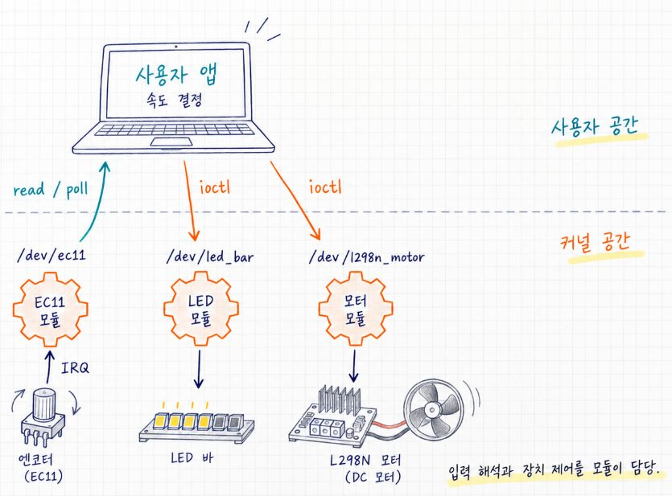
   유저 데몬 ↔ /dev 장치 파일 ↔ 커널 모듈 3개 ↔ 하드웨어

 

### Key Implementation — `/dev/led_bar`

| 영역 | 구현 내용 |
|---|---|
| **장치 추상화** | 40핀 헤더에 흩어진 GPIO 8개를 배열로 묶어 하나의 장치 파일로 제공 |
| **보드 이식성** | `gpiochip_find("tegra234-gpio")`로 GPIO base를 런타임에 탐색, 핀 오프셋 · active-low는 `module_param` |
| **인터페이스** | `write()` 문자열 입력(`echo 3 > /dev/led_bar`) · `ioctl` `SET_LEVEL`(0~8) / `SET_RAW`(8bit 마스크) |
| **안정성** | `mutex`로 동시 접근 보호, 초기화 실패 지점별 `goto` 롤백으로 GPIO · chrdev 자원 누수 방지 |
| **버전 대응** | 커널 6.4 전후 `class_create()` 시그니처 차이를 `LINUX_VERSION_CODE`로 분기 |

팀 공통으로 Jetson-IO 핀 Mux 재설정(SPI · I2S 핀 → GPIO / PWM)과 공용 ioctl 헤더(`common_ioctl.h`) 정의를 함께 진행했습니다.

### Gallery

 

<table>
  <tr>
    <td width="50%" align="center">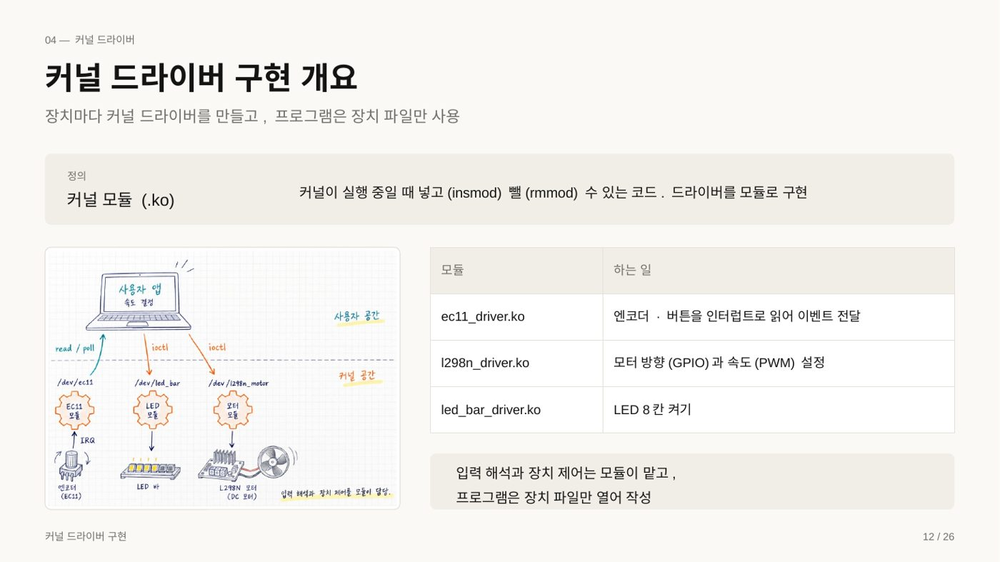  장치별 커널 모듈 구성</td>
    <td width="50%" align="center">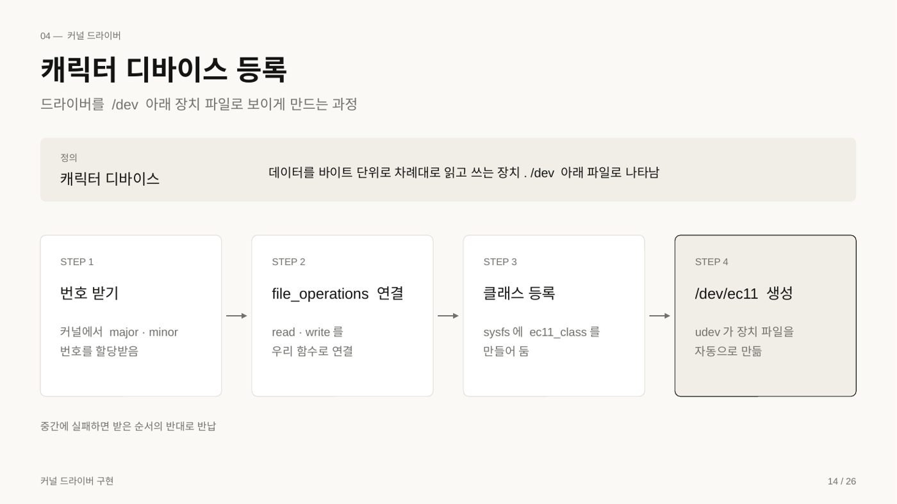  캐릭터 디바이스 등록 흐름</td>
  </tr>
</table>

 

<table>
  <tr>
    <td width="50%" align="center">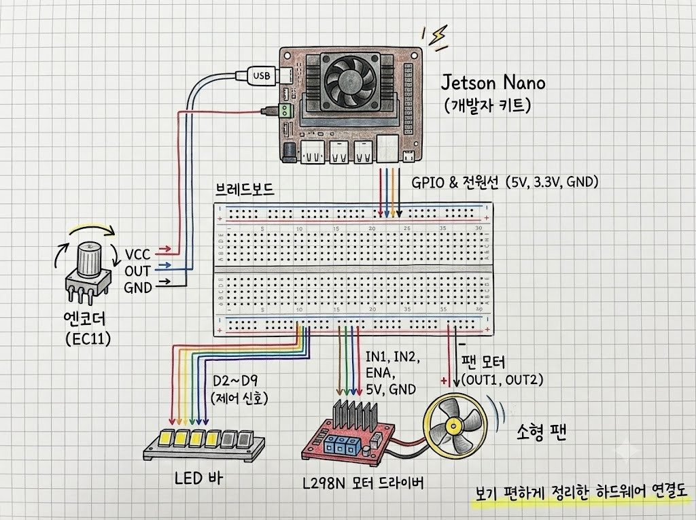  40핀 헤더 배선도</td>
    <td width="50%" align="center">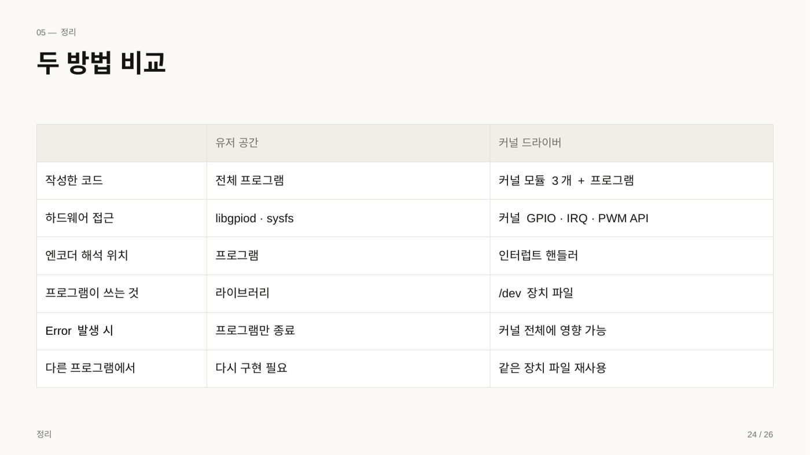  유저 공간 vs 커널 드라이버 비교</td>
  </tr>
</table>

 

<table>
  <tr>
    <td width="50%" align="center">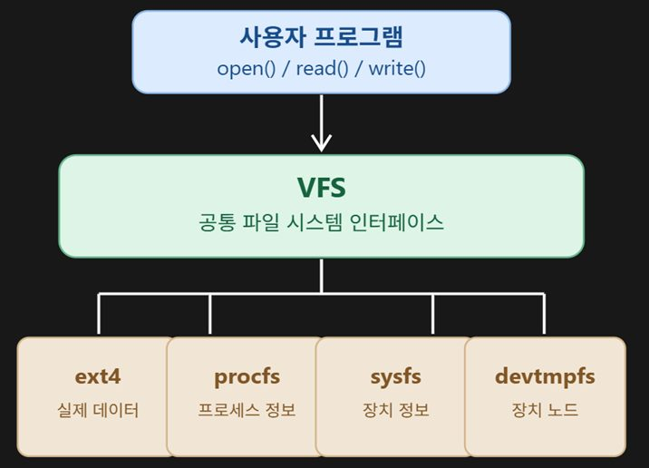  VFS → /dev 계층</td>
    <td width="50%" align="center">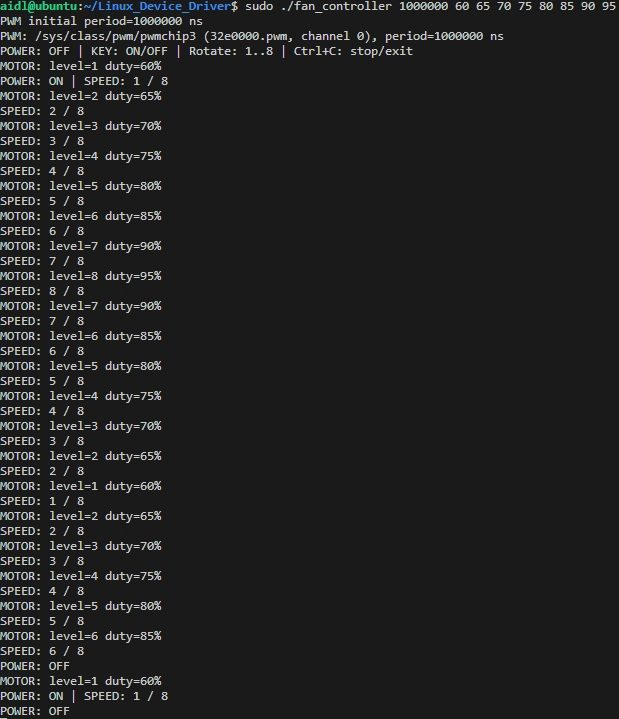  유저 공간 방식 실행 로그</td>
  </tr>
</table>

 

<table>
  <tr>
    <td width="50%" align="center">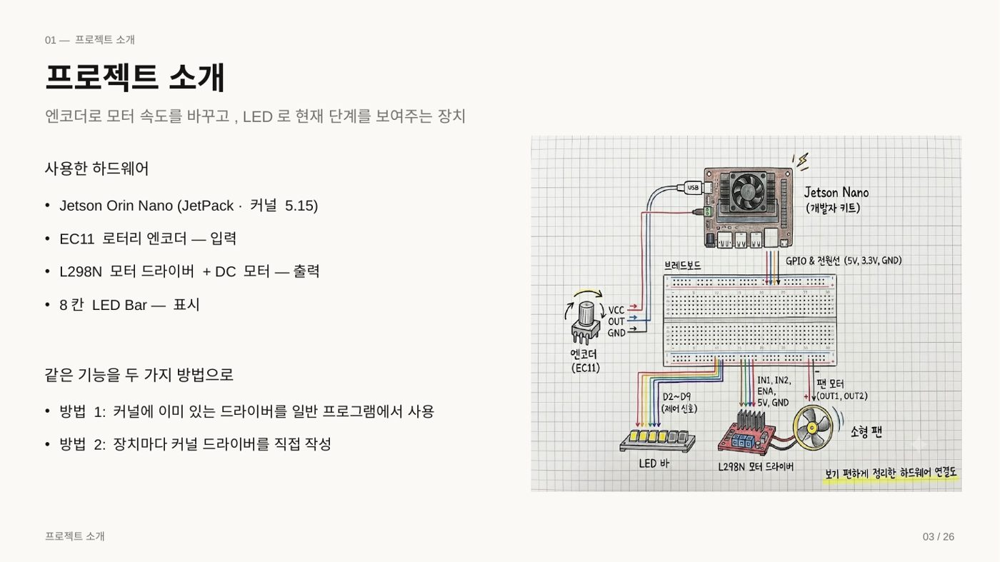  프로젝트 소개</td>
    <td width="50%" align="center">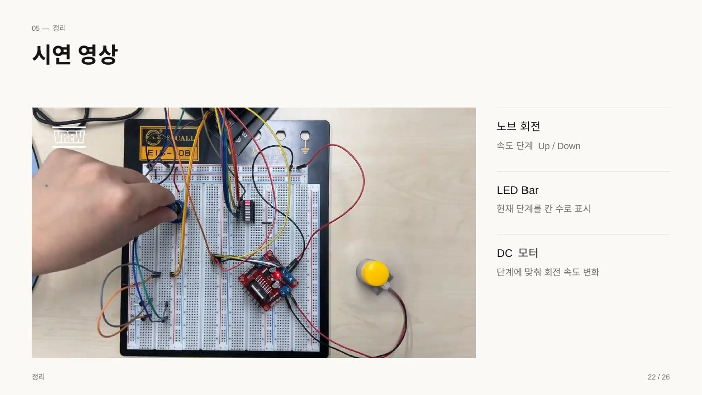  시연 — 노브 · LED Bar · DC 모터</td>
  </tr>
</table>

 

  <a href="./projects/02_linux-device-driver"><b>Source Code</b></a> &nbsp;·&nbsp;
  <a href="./projects/02_linux-device-driver/drivers/led_bar">LED Bar Driver</a>

 

---

## 03. Smart Gate
**로컬 LLM 연동 스마트 차단봉 · 신호등**

<!-- 시연 GIF를 assets/03/demo.gif 로 넣고 주석을 해제하세요

-->

| Period | Team | Role | Environment |
|:-:|:-:|:-:|:-:|
| 2026.08 | 4인 | **펌웨어(`main.cpp`) · GUI(`main.py`) 개편** | NUCLEO-F411RE · STM32 HAL · PlatformIO · PyQt5 |

### Overview
초음파 센서로 장애물을 감지해 서보 차단봉과 신호등을 제어하고, PC GUI와 로컬 LLM(Ollama `qwen2.5:3b`)으로 자연어 제어를 붙인 시스템입니다. 설계 원칙은 **위험한 판단은 펌웨어에 둔다**는 것으로, LLM은 자연어를 허용된 UART 명령으로 바꾸기만 하고 실행 여부는 STM32 FSM이 결정합니다.

 

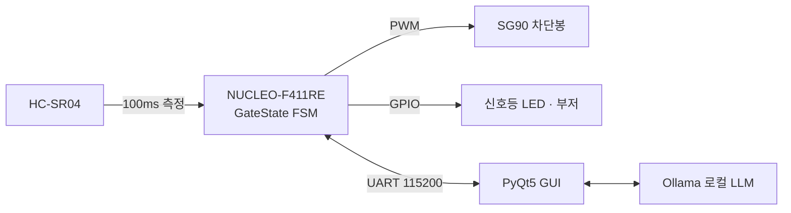

 

### Key Implementation

| 영역 | 구현 내용 |
|---|---|
| **안전 FSM** | CLOSED · OPENING · OPEN · CLOSING · EMERGENCY 5상태, `GATE_OPEN`도 센서 응답 · 거리 재확인 후 거부 가능 |
| **오검출 방지** | 100ms 주기 측정에서 2회 연속 감지될 때만 EMERGENCY 진입 |
| **명령 체계** | 조회 · 제어 · 설정 · 복구 UART 명령, `THRESHOLD:n`으로 재컴파일 없이 감지 거리 변경 |
| **GUI** | 시리얼 수신 · LLM 호출을 QThread로 분리해 화면 멈춤 방지, 최근 사고 3건 기록 |

### Troubleshooting

| Problem | Cause | Solution |
|---|---|---|
| 초음파 센서 무응답 | ECHO 출력 5V ↔ STM32 입력 3.3V | 1kΩ / 2kΩ **분압**, ECHO 핀 PB11 → PA8 재배치 |
| 서보 구동 시 보드 리셋 | 서보 전류로 전원 강하 | **외부 5V 분리** · 공통 GND · 470~1000µF 커패시터 |
| 펌웨어 업로드 실패 | GUI가 시리얼 포트 점유 | 실행 순서 정리 · **배치 스크립트화** |

 

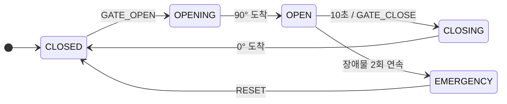

 

  <a href="./projects/03_smart-gate-stm32"><b>Source Code</b></a> &nbsp;·&nbsp;
  <a href="./projects/03_smart-gate-stm32/docs/PROTOCOL.md">UART Protocol</a> &nbsp;·&nbsp;
  <a href="./projects/03_smart-gate-stm32/docs/WIRING.md">Wiring</a>

 

---

## 04. FPGA Microwave
**Basys3 Verilog 전자레인지 컨트롤러**

<!-- 보드 사진 · 시뮬레이션 캡처를 assets/04/ 에 넣고 주석을 해제하세요

 

<table><tr>
  <td width="50%" align="center">  Basys3 동작</td>
  <td width="50%" align="center">  테스트벤치 PASS 로그</td>
</tr></table>
-->

| Team | Environment |
|:-:|:-:|
| 개인 | Basys3 (XC7A35T, 100MHz) · Verilog · Vivado |

### Overview
로터리 엔코더로 조리 시간을 맞추고 서보(문) · DC 모터(턴테이블) · 부저 · FND를 제어하는 전자레인지입니다. 조리 중 문이 열리면 즉시 일시정지하고, 문이 열린 상태에서는 재시작을 거부하도록 메인 FSM을 설계했습니다.

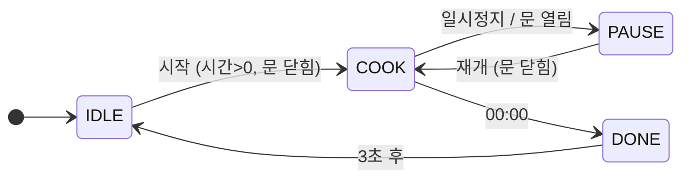

### Troubleshooting

| Problem | Solution |
|---|---|
| 로터리 채터링으로 값이 튐 | detent 복귀 시 **누적 전이 수의 부호**로 방향 판정 (정상 ±3, 채터링 ±1 제거) |
| 서보 떨림 · 발열 | 목표 도착 1초 후 **PWM 차단**, 1ms마다 1µs씩 펄스폭 이동 |
| L298N이 PWM을 따라가지 못함 | 모터 PWM 주파수를 **1kHz**로 변경 |
| tick을 클럭으로 쓰는 FND 스캔 | `clk` + **tick enable** 구조로 클럭 도메인 통일 |

버튼 · 로터리 입력에 채터링을 넣은 테스트벤치로 시나리오별 `[PASS]` / `[FAIL]`을 자동 판정했습니다.

  <a href="./projects/05_fpga-microwave"><b>Source Code</b></a>

 

---

## 05. Autonomous RC Car
**ATmega128A 3채널 초음파 자율주행**

<!-- 주행 GIF를 assets/05/driving.gif 로 넣고 주석을 해제하세요

-->

| Team | Environment |
|:-:|:-:|
| 개인 | ATmega128A @16MHz · Bare-metal C · Microchip Studio |

### Overview
블루투스 수동 조종과 초음파 자율주행을 버튼 하나로 전환하는 RC카입니다.

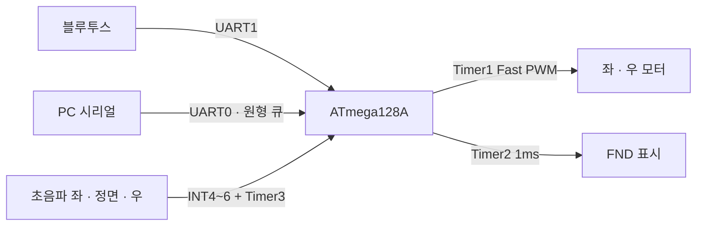

### Key Implementation

| 영역 | 구현 내용 |
|---|---|
| **거리 측정** | 좌 · 정면 · 우 초음파 3채널을 60ms 주기로 순차 측정, 에코는 외부 인터럽트 + Timer3 |
| **회피 로직** | 양옆이 막히면 후진, 2초 이상 갇히면 1초 탈출 후진 후 재판단 |
| **모터 제어** | Timer1 Fast PWM(Mode 14, TOP=1023)으로 좌우 바퀴 속도 개별 제어 |
| **구조** | UART 2채널 명령 입력, 모드별 동작을 함수 포인터 배열로 분기 |

  <a href="./projects/06_atmega128-auto-car"><b>Source Code</b></a>

 

---

## 06. YOLO RPS Game
**YOLO 가위바위보 2인 판정 게임**

<!-- 실행 캡처를 assets/06/game.png 로 넣고 주석을 해제하세요

-->

| Team | Environment |
|:-:|:-:|
| 개인 | Ultralytics YOLO11n · ONNX · TensorRT |

### Overview
웹캠에 비친 두 손을 인식해 가위바위보 승부를 판정합니다. 공개 데이터셋과 직접 수집한 데이터를 합쳐 학습하고, PC용 ONNX 추론과 TensorRT 추론을 분리해 구성했습니다.

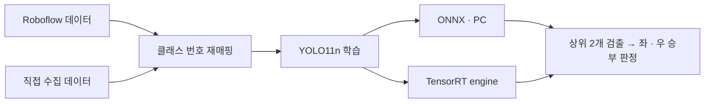

### Key Implementation

| 영역 | 구현 내용 |
|---|---|
| **데이터** | 두 데이터셋 병합 시 클래스 번호를 `data.yaml` 기준으로 재매핑 |
| **판정** | 신뢰도 상위 2개 검출만 플레이어로 선택, x좌표로 좌 · 우 구분 |
| **추론** | ONNX(PC) 버전과 TensorRT 추론 모듈(`trt_module.py`) 분리 |

  <a href="./projects/07_yolo-rps-game"><b>Source Code</b></a>

 

---

## 07. AgeApt
**AI 연령 분석 맞춤형 영화관 키오스크 · 캡스톤디자인 경진대회 우수상**

  
   React 키오스크 · Spring Boot 백엔드 · Flask 연령 추정 서버 · MySQL

| Period | Team | Role | Environment |
|:-:|:-:|:-:|:-:|
| 2024.09 ~ 2025.03 | 4인 | **Back-end · DevOps** | Spring Boot · JPA · MySQL · Docker · AWS EC2 |

### Overview
카메라로 사용자의 연령대를 추정해 UI를 바꿔 주는 영화관 키오스크입니다. 백엔드를 주로 작성하고, 개발 환경 구성부터 EC2 배포까지 맡았습니다.

### Key Implementation

| 영역 | 구현 내용 |
|---|---|
| **예매** | 영화 조회 · 좌석 지정 · 예매 API, 요청 좌석 중복 검사와 잔여 좌석 차감 |
| **외부 연동** | TMDB API로 인기 영화 · 장르 저장 및 상영 시간 생성, 카카오페이 결제 준비, 예매 완료 SMS |
| **배포** | BE 환경 구성 → MySQL 연동 → Docker 이미지화 → EC2 배포 |

### Gallery

<table>
  <tr>
    <td width="50%" align="center">  키오스크 예매 화면</td>
    <td width="50%" align="center">  영화 불러오기 API 응답</td>
  </tr>
</table>

 

<table>
  <tr>
    <td width="50%" align="center">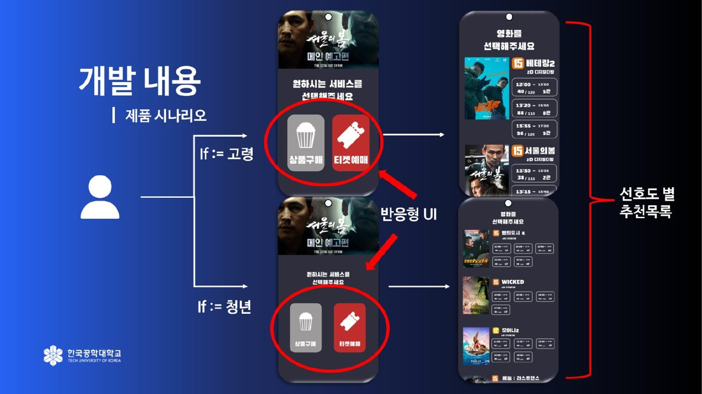  연령대별 반응형 UI</td>
    <td width="50%" align="center">  촬영 → 연령 추정 → 예매 흐름</td>
  </tr>
</table>

 

  <a href="https://github.com/minjaon/AgeApt"><b>GitHub Repository</b></a>

 

