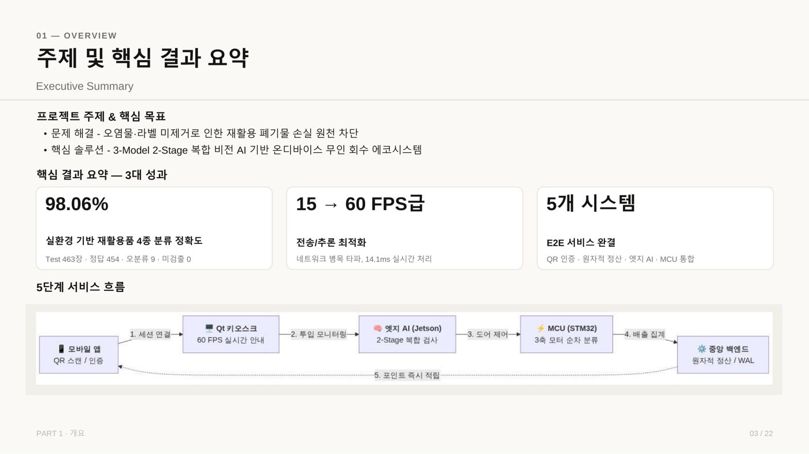
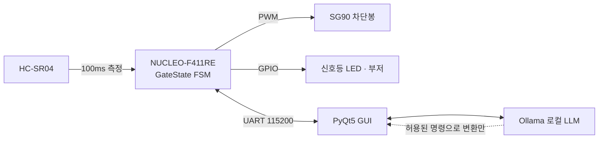
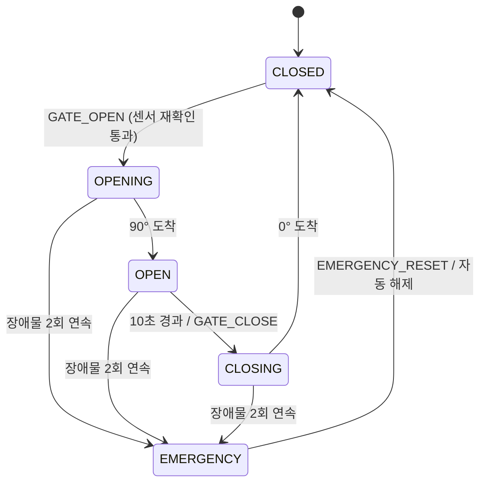
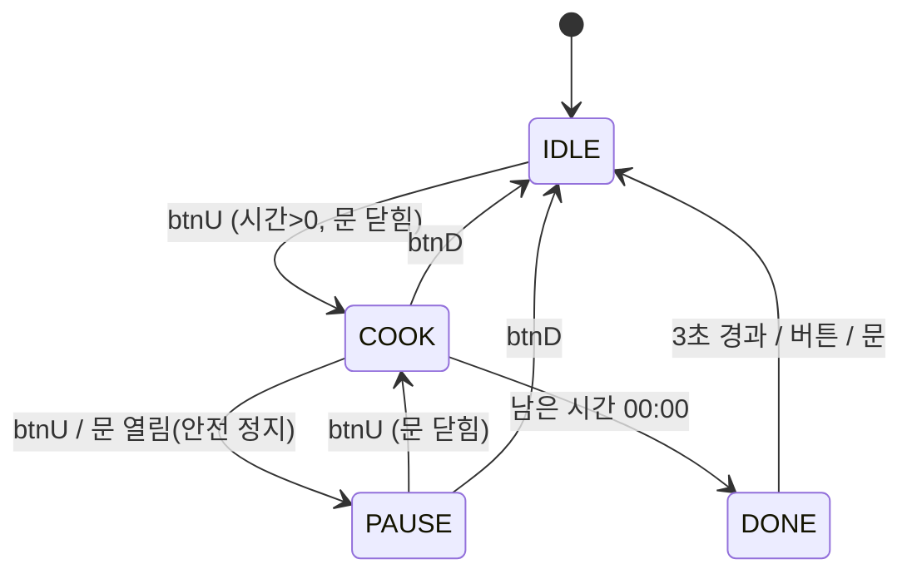
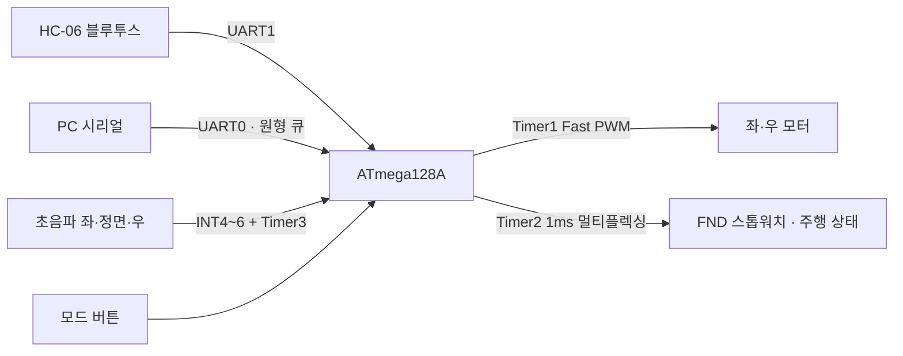
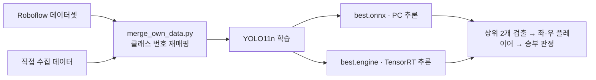
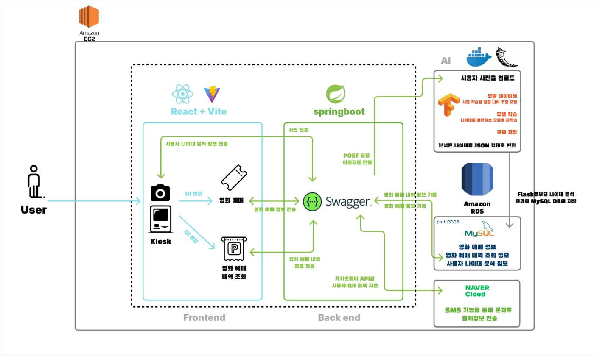
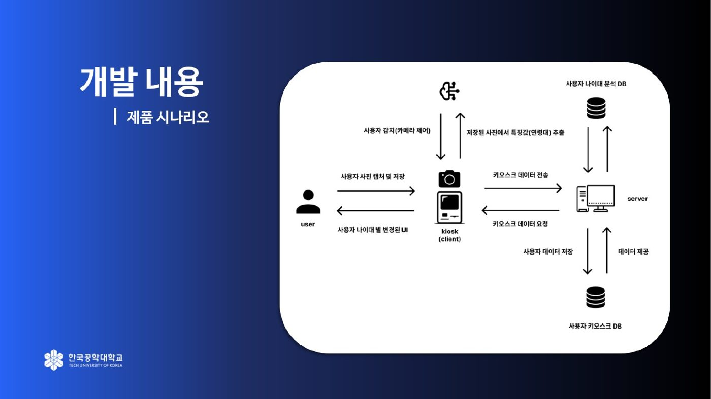

# Embedded Firmware Portfolio · 석민정

MCU 레지스터부터 리눅스 커널 드라이버, FPGA까지 — 하드웨어가 실제로 움직이는 코드를 작성합니다.

[](https://github.com/minjaon)


- 한국공학대학교 컴퓨터공학전공 (2027.02 졸업예정)
- 시스템 반도체 SW 설계 과정 (대한상공회의소 서울기술교육센터, 2026.05 ~ 2026.12)

<p align="center">
  
  
  
</p>

---

## 한눈에 보기

| # | 프로젝트 | 플랫폼 | 핵심 기술 | 형태 | 담당 |
|:-:|---|---|---|:-:|---|
| 01 | [AI 분리수거 키오스크 — 분류 기구 펌웨어](#01-ai-분리수거-키오스크--분류-기구-펌웨어) | STM32F411 | Bare-metal C, PLL·TIM·USART 레지스터 설정, 서보 3축, 초음파 4채널 | 4인 | **MCU 펌웨어 전담** |
| 02 | [Jetson 리눅스 커널 디바이스 드라이버](#02-jetson-orin-nano-리눅스-커널-디바이스-드라이버) | Jetson Orin Nano | Linux Kernel Module, Char Device, GPIO·PWM 서브시스템, ioctl | 4인 | **8-Bar LED 드라이버** |
| 03 | [로컬 LLM 연동 스마트 차단봉·신호등](#03-로컬-llm-연동-스마트-차단봉신호등) | NUCLEO-F411RE | STM32 HAL, FSM, UART 프로토콜, PyQt5 QThread | 4인 | **펌웨어·GUI 개편** |
| 04 | [Basys3 전자레인지 컨트롤러](#04-basys3-전자레인지-컨트롤러-verilog) | Basys3 (Artix-7) | Verilog HDL, FSM, PWM, 테스트벤치 자동 검증 | 개인 | 전체 |
| 05 | [3채널 초음파 자율주행 RC카](#05-3채널-초음파-자율주행-rc카) | ATmega128A | Bare-metal C, Timer PWM, 외부 인터럽트, UART 원형 큐 | 개인 | 전체 |
| 06 | [YOLO 가위바위보 판정 게임](#06-yolo-가위바위보-판정-게임) | PC · TensorRT | YOLO11n 학습, ONNX / TensorRT 추론 | 개인 | 전체 |
| 07 | [ageAPT — 연령 반응형 영화관 키오스크](#07-ageapt--연령-반응형-영화관-키오스크) | AWS EC2 | Spring Boot, JPA, MySQL, Docker | 4인 | **백엔드·배포** |

### 기술 스택

| 분야 | 사용 경험 |
|---|---|
| MCU | STM32F411 (Bare-metal · HAL), ATmega128A |
| 빌드 / 디버깅 | arm-none-eabi-gcc, Makefile, 링커 스크립트·스타트업 코드, PlatformIO, Microchip Studio, ST-Link |
| 주변장치 | GPIO, SysTick, TIM PWM / Input 측정, USART 인터럽트, EXTI |
| Embedded Linux | Kernel Module(`.ko`), Character Device, `file_operations`, ioctl, Tegra GPIO / PWM, Jetson-IO 핀 Mux |
| HDL | Verilog, Vivado, Testbench 시뮬레이션 |
| 응용 / 서버 | C++, Python, PyQt5, YOLO·TensorRT, Spring Boot, MySQL, Docker |

---

## 01. AI 분리수거 키오스크 — 분류 기구 펌웨어

> **STM32F411 · Bare-metal C · 4인 팀(MCU 제어 담당) · 2026.09**
> 📁 [`01_smart-recycling-stm32-baremetal`](./01_smart-recycling-stm32-baremetal) · 📄 [MCU 펌웨어 상세](./01_smart-recycling-stm32-baremetal/mcu_firmware/README.md) · 📊 [최종 발표자료](./01_smart-recycling-stm32-baremetal/docs/presentation/smart_recycling_final_report.pdf)

<p align="center">
  
  <br/><em>통합 시연 — 재질 판별 → 분류 통로 정렬 → 투입구 개방 → 앱으로 결과 전달</em>
</p>

Jetson이 재질(종이·캔·PET·비닐)을 판별해 UART로 명령을 보내면, STM32가 서보 3축으로 통로를 맞추고 4개 수거함의 적재율을 보고하는 키오스크입니다. **`mcu_firmware/` 전체를 담당**했습니다.

```
Jetson (TensorRT) ──UART 115200──▶ STM32F411 ──TIM3 PWM──▶ 서보 3축 (상단 도어 / 분류판 2개)
                  ◀── $DOOR_STATE, $BIN ──     ──TIM4 1µs──▶ 초음파 4채널 (수거함 적재율)
```

<table>
  <tr>
    <td width="38%" align="center"><br/><sub>직접 제어한 3축 분류 기구 · 4구역 수거함</sub></td>
    <td width="62%" align="center"><br/><sub>하드웨어 결과물 — 3채널 서보 분류 기구 + 4구역 적재율 표시</sub></td>
  </tr>
</table>

**HAL 없이 레지스터로 구성**
- 스타트업 코드(`crt0.s`)·링커 스크립트(`rom_0x08000000.lds`)·Makefile로 빌드 환경 구성
- HSI 16MHz → PLL 96MHz, 플래시 wait state 설정 / SysTick 1ms
- USART2 RX 인터럽트로 Jetson 명령 수신, USART1은 디버그 로그 전용으로 분리
- TIM3 3채널 50Hz PWM(0.5~2.5ms) 서보 구동, TIM4 1µs 카운터로 초음파 에코 폭 측정

**기구의 물리적 한계를 펌웨어로 처리**
- **순차 인터록**: 상단 도어와 분류판이 동시에 움직이면 통로가 맞기 전에 물체가 떨어짐 → 하단 2축 램프 완료(`Servo_Is_Moving()`) 후 상단 도어 개방
- **각도 램프 120°/s**: 급격한 구동으로 기구가 파손되는 문제를 소프트웨어 속도 제한으로 해결
- **부팅 순차 정렬**: 서보 3개 동시 구동 시 돌입전류로 5V가 떨어짐 → 시간차를 두고 하나씩 초기 위치로 이동
- **도어 타이머**: 개방 후 최소 2초 유지, 10초 경과 시 자체 중립 복귀

**적재율 3단계 필터** (`bin_filter.c`)
1. 투입 직후 2초 블랭킹 (낙하 중인 물체 측정 배제)
2. 최근 5샘플 중앙값 ±5cm 이탈값 제외 후 평균
3. 이전 값과 5%p 이상 차이날 때만 갱신 → 화면 수치 떨림 억제

<table>
  <tr>
    <td width="33%" align="center"><br/><sub>정상 판정 → 분류·개방 명령</sub></td>
    <td width="33%" align="center"><br/><sub>라벨 미제거 → 개방 차단</sub></td>
    <td width="33%" align="center"><br/><sub>내용물 오염 → 개방 차단</sub></td>
  </tr>
</table>

<table>
  <tr>
    <td width="60%" align="center"><br/><sub>E2E 시연 — 회원 QR 인증 후 투입 결과가 앱에 반영</sub></td>
    <td width="13%" align="center"><br/><sub>QR 연결</sub></td>
    <td width="13%" align="center"><br/><sub>배출 완료</sub></td>
    <td width="13%" align="center"><br/><sub>이력 조회</sub></td>
  </tr>
</table>

<details>
<summary>📊 팀 발표자료 더 보기</summary>
<br/>
<p align="center">
  <br/><sub>프로젝트 핵심 결과 요약 (팀 전체)</sub><br/><br/>
  <br/><sub>Qt 키오스크 대시보드 · Android 앱 (팀원 담당)</sub>
</p>
</details>

`C` `STM32F411` `Bare-metal` `CMSIS` `USART` `TIM PWM` `SysTick` `HC-SR04` `SG90`

---

## 02. Jetson Orin Nano 리눅스 커널 디바이스 드라이버

> **Jetson Orin Nano · Linux 5.15-tegra · 4인 팀(LED Bar 드라이버 담당) · 2026.10**
> 📁 [`02_jetson-linux-device-driver`](./02_jetson-linux-device-driver) · 📊 [발표자료](./02_jetson-linux-device-driver/docs/presentation/linux_device_driver_final.pptx)

<table>
  <tr>
    <td width="50%" align="center"><br/><sub>엔코더 회전 → 모터 PWM 속도 · LED 레벨 미터 실시간 연동</sub></td>
    <td width="50%" align="center"><br/><sub>Jetson Orin Nano + EC11 엔코더 + L298N + 8-Bar LED</sub></td>
  </tr>
</table>

EC11 엔코더 회전으로 DC 모터 속도를 조절하고 8-Bar LED에 단계를 표시하는 시스템을, **유저 공간 제어(libgpiod·sysfs)와 커널 캐릭터 디바이스 드라이버 두 방식으로 구현해 비교**한 프로젝트입니다. 드라이버 3개(엔코더·모터·LED)를 팀원이 하나씩 맡았고, 저는 **`led_bar_driver.ko`** 를 작성했습니다.

<p align="center">
  
  <br/><em>유저 데몬 ↔ /dev 장치 파일 ↔ 커널 모듈 3개 ↔ 하드웨어</em>
</p>

**담당: WCNLB8-SR12 8-Bar LED 드라이버**
- 40핀 헤더에 흩어진 GPIO 8개를 배열로 묶어 하나의 `/dev/led_bar` 장치로 추상화
- `gpiochip_find("tegra234-gpio")`로 GPIO base를 런타임에 찾아 보드·커널 버전에 따른 번호 차이 대응
- 핀 오프셋·active-low 여부를 `module_param`으로 노출 → 재컴파일 없이 배선 변경 대응
- 인터페이스 2종: `write()` 문자열(`echo 3 > /dev/led_bar`) / `ioctl` `SET_LEVEL`(0~8 레벨 미터)·`SET_RAW`(8bit 마스크)
- `mutex`로 동시 접근 보호, 초기화 실패 지점별 `goto` 롤백으로 GPIO·chrdev 자원 누수 방지
- 커널 6.4 전후 `class_create()` 시그니처 차이를 `LINUX_VERSION_CODE`로 분기

**팀 공통 작업**
- Jetson-IO로 40핀 헤더 Mux 재설정(SPI·I2S 핀 → GPIO/PWM), 3.3V 로직 레벨·공통 GND 배선 규칙 정리
- 공용 ioctl 헤더(`include/common_ioctl.h`)로 드라이버-데몬 간 명령 번호 통일

<table>
  <tr>
    <td width="50%" align="center"><br/><sub>장치별 커널 모듈 구성 (ec11 · l298n · led_bar)</sub></td>
    <td width="50%" align="center"><br/><sub>캐릭터 디바이스 등록 흐름 — 번호 할당 → fops 연결 → 클래스 → /dev 생성</sub></td>
  </tr>
  <tr>
    <td width="50%" align="center"><br/><sub>40핀 헤더 배선도</sub></td>
    <td width="50%" align="center"><br/><sub>유저 공간 vs 커널 드라이버 비교</sub></td>
  </tr>
</table>

<details>
<summary>📊 발표자료 · 실행 로그 더 보기</summary>
<br/>
<p align="center">
  <br/><sub>프로젝트 소개 — 사용 하드웨어와 두 가지 구현 방식</sub><br/><br/>
  <br/><sub>VFS를 거쳐 /dev 장치 파일로 연결되는 계층</sub><br/><br/>
  <br/><sub>유저 공간 방식(libgpiod · sysfs PWM) 실행 로그</sub><br/><br/>
  <br/><sub>시연 — 노브 회전 · LED Bar · DC 모터</sub>
</p>
</details>

`C` `Linux Kernel Module` `Character Device` `GPIO` `PWM` `ioctl` `Jetson Orin Nano`

---

## 03. 로컬 LLM 연동 스마트 차단봉·신호등

> **NUCLEO-F411RE · STM32 HAL(C++) + PyQt5 · 4인 팀 · 2026.08**
> 📁 [`03_stm32-smart-gate-llm`](./03_stm32-smart-gate-llm) · 📄 [UART 프로토콜](./03_stm32-smart-gate-llm/docs/PROTOCOL.md) · [배선도](./03_stm32-smart-gate-llm/docs/WIRING.md)

<!-- 📷 시연 사진/GIF를 assets/03/ 에 넣고 아래 주석을 해제하세요
<p align="center"></p>
-->

초음파 센서로 장애물을 감지해 서보 차단봉과 신호등을 제어하고, PC GUI와 로컬 LLM(Ollama `qwen2.5:3b`)으로 자연어 제어·사고 요약을 붙인 시스템입니다. 팀원이 올린 초기 버전에서 **펌웨어(`main.cpp`)와 GUI(`main.py`)를 대폭 개편**했습니다.





**안전 판단은 펌웨어에 둔다**
- LLM은 자연어를 허용된 UART 명령으로 바꾸기만 하고, 실행 여부는 STM32 FSM이 결정
- `GATE_OPEN`을 받아도 펌웨어가 센서 응답·현재 거리를 다시 확인한 뒤 조건이 안 맞으면 거부
- 100ms 주기 측정에서 **2회 연속** 감지될 때만 EMERGENCY 진입 → 순간 튐 값으로 차단봉이 닫히지 않음

**HW 디버깅**
- 초음파 무응답 → HC-SR04 ECHO 5V / STM32 3.3V 입력 확인 → 1kΩ·2kΩ 분압, ECHO 핀 PB11 → PA8 재배치
- 서보 구동 시 보드 리셋 → 외부 5V 분리, 공통 GND, 470~1000µF 커패시터

**PC GUI**
- USART2 115200bps 명령 체계(조회·제어·설정·복구), `THRESHOLD:n`으로 재컴파일 없이 감지 거리 변경
- 시리얼 수신·LLM 호출을 QThread로 분리해 UI 멈춤 방지, 최근 사고 3건 기록

`C++` `STM32 HAL` `PlatformIO` `FSM` `UART` `Python` `PyQt5` `Ollama`

---

## 04. Basys3 전자레인지 컨트롤러 (Verilog)

> **Basys3 (XC7A35T, 100MHz) · Vivado · 개인**
> 📁 [`04_fpga-microwave-verilog`](./04_fpga-microwave-verilog)

<!-- 📷 보드 동작 사진과 시뮬레이션 PASS 로그 캡처를 assets/04/ 에 넣고 주석을 해제하세요
<table><tr>
  <td width="50%" align="center"><br/><sub>Basys3 동작</sub></td>
  <td width="50%" align="center"><br/><sub>테스트벤치 PASS/FAIL 로그</sub></td>
</tr></table>
-->

로터리 엔코더로 시간을 설정하고 서보(문)·DC 모터(턴테이블)·부저·FND를 제어하는 전자레인지를 Verilog로 설계했습니다.



- **로터리 채터링 처리**: detent 복귀 시 누적 전이 수의 부호로 방향 판정 (정상 한 칸 ±3, 채터링 ±1 → 걸러짐)
- **서보 떨림·발열**: 목표 각도 도착 1초 후 PWM 출력 차단, 1ms마다 1µs씩 펄스폭을 옮겨 부드럽게 개폐
- **모터 PWM**: 실습 모듈의 고주파 PWM을 L298N이 따라가지 못해 1kHz로 변경
- **클럭 도메인 통일**: tick을 클럭으로 쓰던 FND 스캔을 `clk` + tick enable 구조로 수정
- **검증**: 버튼·로터리에 채터링을 넣은 테스트벤치로 시나리오별 `[PASS]/[FAIL]` 자동 판정

`Verilog` `FPGA` `Vivado` `FSM` `PWM` `Testbench`

---

## 05. 3채널 초음파 자율주행 RC카

> **ATmega128A @16MHz · Bare-metal C · Microchip Studio · 개인**
> 📁 [`05_atmega128-autonomous-car`](./05_atmega128-autonomous-car)

<!-- 📷 주행 GIF를 assets/05/ 에 넣고 주석을 해제하세요
<p align="center"></p>
-->

블루투스 수동 조종과 초음파 자율주행을 버튼 하나로 전환하는 RC카입니다.



- 좌·정면·우 초음파 3채널을 60ms 주기로 순차 측정 (에코: INT4~6 외부 인터럽트 + Timer3)
- 양옆이 동시에 막히면 후진, 2초 이상 갇히면 1초 탈출 후진 후 재판단
- Timer1 Fast PWM(Mode 14, TOP=1023)으로 좌우 바퀴 속도 개별 제어
- UART0(PC, 원형 큐)·UART1(블루투스) 이중 명령 입력, 모드별 동작을 함수 포인터 배열로 분기
- Timer2 1ms 인터럽트로 FND에 스톱워치와 주행 상태 동시 멀티플렉싱

`C` `AVR` `ATmega128A` `Timer PWM` `External Interrupt` `UART`

---

## 06. YOLO 가위바위보 판정 게임

> **PC · Ultralytics YOLO11n · ONNX / TensorRT · 개인**
> 📁 [`06_yolo-rps-tensorrt`](./06_yolo-rps-tensorrt)

<!-- 📷 게임 실행 캡처를 assets/06/ 에 넣고 주석을 해제하세요
<p align="center"></p>
-->

웹캠에 비친 두 손을 인식해 2인 가위바위보 승부를 판정합니다.



- Roboflow 데이터셋 + 직접 수집 데이터 병합 시 클래스 번호를 `data.yaml` 기준으로 재매핑
- YOLO11n 전이학습 (`train_pc.py`, Colab 노트북 포함)
- 신뢰도 상위 2개 검출만 플레이어로 선택하고 x좌표로 좌·우 구분
- ONNX(PC) 추론 버전과 TensorRT `.engine` 추론 모듈(`trt_module.py`) 분리 구성

`Python` `YOLO` `ONNX` `TensorRT` `OpenCV`

---

## 07. ageAPT — 연령 반응형 영화관 키오스크

> **Spring Boot · MySQL · Docker · AWS EC2 · 4인 팀(Back-end · DevOps) · 2024.09 ~ 2025.03 · 캡스톤디자인 경진대회 우수상**
> 🔗 [GitHub 저장소](https://github.com/minjaon/AgeApt)

카메라로 사용자의 연령대를 추정해 UI를 바꿔 주는 영화관 키오스크입니다. **백엔드(`JZP_BE`)를 주로 작성**하고 Docker로 EC2에 배포했습니다.

<p align="center">
  
  <br/><em>시스템 구성도 — React 키오스크 · Spring Boot 백엔드 · Flask 연령 추정 서버 · MySQL</em>
</p>

- 영화 조회·좌석 지정·예매 API, 요청 좌석 중복 검사와 잔여 좌석 차감
- TMDB API로 인기 영화·장르를 받아 DB에 저장하고 상영 시간 생성
- 카카오페이 결제 준비 연동, 예매 완료 시 SMS 발송
- BE 환경 구성 → MySQL 연동 → Docker 이미지화 → EC2 배포

<table>
  <tr>
    <td width="50%" align="center"><br/><sub>키오스크 영화 예매 화면</sub></td>
    <td width="50%" align="center"><br/><sub>영화 불러오기 API 응답</sub></td>
  </tr>
  <tr>
    <td width="50%" align="center"><br/><sub>연령대에 따라 달라지는 UI 시나리오</sub></td>
    <td width="50%" align="center"><br/><sub>촬영 → 연령 추정 → 예매 → 기록 흐름</sub></td>
  </tr>
</table>

`Java` `Spring Boot` `JPA` `MySQL` `Docker` `AWS EC2`

---

## 저장소 구조

```
portfolio/
├── README.md
├── assets/                               # README용 이미지 (발표자료 캡처 등)
│   ├── 01/  02/  07/
├── 01_smart-recycling-stm32-baremetal/   # 팀 전체 코드 포함, 담당은 mcu_firmware/
├── 02_jetson-linux-device-driver/        # 담당: drivers/led_bar/
├── 03_stm32-smart-gate-llm/              # STM32_Firmware/, PC_GUI/
├── 04_fpga-microwave-verilog/
├── 05_atmega128-autonomous-car/
└── 06_yolo-rps-tensorrt/
```

> 팀 프로젝트는 원본 저장소 전체를 포함하되, 각 섹션에 본인 담당 범위를 표시했습니다. ageAPT는 데이터셋·모델 파일 용량이 커서 원본 저장소 링크로 대신합니다.
