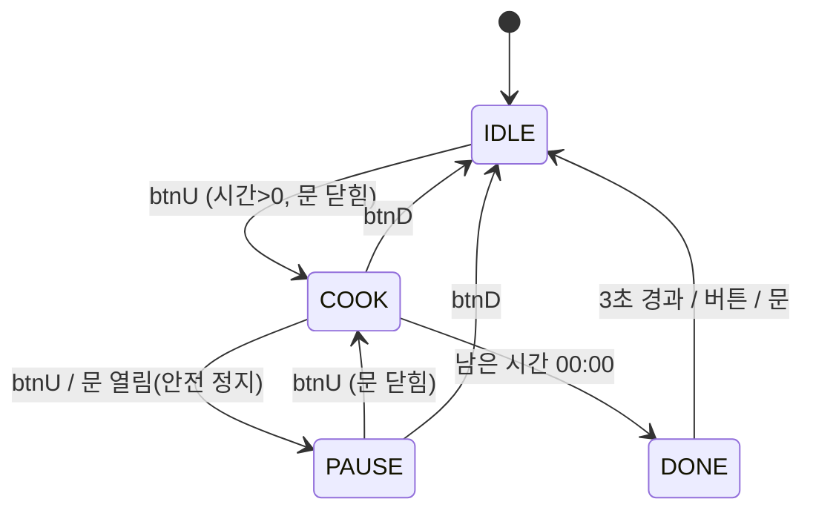

# Basys3 전자레인지 (Verilog HDL)

Basys3(Artix-7) 보드에서 로터리 엔코더로 시간을 설정하고, 서보(문)·DC 모터(턴테이블)·부저·FND를 제어하는 전자레인지 컨트롤러입니다. 메인 FSM과 주변장치 모듈을 Verilog로 작성하고, 채터링을 넣은 테스트벤치로 자동 PASS/FAIL 검증했습니다.

| 항목 | 내용 |
|---|---|
| 보드 | Digilent Basys3 (XC7A35T, 100MHz) |
| 도구 | Vivado — `microwave.xpr`로 열기 |
| Top / Sim top | `top_microwave` / `tb_top_microwave` |

## 파일 구성

| 파일 | 내용 |
|---|---|
| `sources_1/new/top_microwave.v` | Top + 메인 FSM, tick(1us·1ms), 버튼 엣지 검출, LED 출력 |
| `sources_1/new/rotary_decoder.v` | `rotary_decoder`(KY-040 디코더) + `sound_player`(부저 효과음 시퀀서) |
| `sources_1/new/servo_ctrl.v` | `servo_ctrl`(문 서보 50Hz PWM) + `motor_pwm`(DC 모터 1kHz PWM) |
| `sources_1/new/fnd_controller.v` | 4자리 FND 스캔, 시간·circle 애니메이션·깜빡임 표시 |
| `sources_1/new/btn_debounce.v` | 디바운서 (실습 모듈 재사용) |
| `constrs_1/.../Basys3-Master_orginal.xdc` | 핀 배정 |
| `sim_1/new/tb_top_microwave.v` | 테스트벤치 (채터링 포함, 자동 PASS/FAIL) |

실습에서 가져온 부분은 디바운서, 로터리 상태천이 표, 멜로디 반주기 토글 방식, FND 세그먼트 표, tick 생성 방식입니다. FSM, 서보 제어, 효과음 시퀀서, circle 표시는 새로 작성했습니다.

## 조작

| 입력 | 기능 |
|---|---|
| 로터리 회전 | 시간 설정. 초 모드 ±10초, 분 모드 ±1분 (최대 99:59). 조리 중에도 조절 가능 |
| 로터리 누름 | 분 / 초 설정 모드 전환 |
| btnU | 시작 → 일시정지 → 재시작 |
| btnD | 취소 (00:00, IDLE) |
| btnL | 문 열기 / 닫기 |
| btnR | 모터 출력 1 → 5단계 (duty 40/55/70/85/100 %) |
| SW15 | reset |

## FSM

| 상태 | FND | 모터 | 비고 |
|---|---|---|---|
| IDLE | 설정 시간 MM.SS | 정지 | 문 열림 또는 0초에서 시작하면 에러음 |
| COOK | circle 애니메이션 ↔ 남은 시간 (1초씩) | 출력 단계 duty로 회전 | 조리 중 문을 열면 PAUSE로 전환 |
| PAUSE | 남은 시간 깜빡임 | 정지 | 문이 열려 있으면 재시작 불가 (에러음) |
| DONE | 00.00 3회 깜빡임 + 종료 멜로디 | 정지 | 3초 후 IDLE |

LED: `15` 문 열림 · `14` 모터 PWM · `13` 일시정지 · `12` 완료 · `11/10` 분/초 모드 · `4~0` 출력 단계

## 설계 메모

- **로터리 오동작 방지**: 실습 상태천이 표를 쓰되, 정지(detent) 위치로 돌아왔을 때 누적 전이 수의 부호로 방향을 판정합니다. 정상 한 칸은 ±3, 채터링 한 번은 ±1이라 걸러집니다.
- **서보 발열·떨림**: 목표 각도 도착 후 1초(`HOLD_MS`)가 지나면 PWM을 끕니다. 문은 기어 마찰로 그 자리에 유지되고, 목표가 바뀌면 다시 출력합니다. 문은 1ms마다 1us씩 펄스폭을 옮겨 부드럽게 열립니다(1.0ms 닫힘 ↔ 1.5ms 열림).
- **모터 PWM 주파수**: 실습 모듈의 10MHz PWM은 L298N이 따라가지 못해 1kHz로 낮췄습니다.
- **클럭 도메인 통일**: 실습 FND 스캔은 tick을 클럭으로 썼는데, `clk` + tick enable 방식으로 바꿔 클럭 도메인을 하나로 맞췄습니다.
- **로터리 키**: KY-040 SW는 active-low라 반전 후 엣지를 검출하고, 리셋 직후 가짜 눌림이 생기지 않도록 이전값을 1로 초기화합니다.

## 배선 (Pmod)

| 포트 | 핀 | 연결 |
|---|---|---|
| JC1 / JC2 / JC3 / JC4 | K17 / M18 / N17 / P18 | 부저 + / KY-040 CLK / DT / SW |
| JA1 / JA2 / JA3 | J1 / L2 / J2 | L298N ENA / IN2 / IN1 (공통 GND 필수) |
| JB1 | A14 | 서보 SG90 신호 (전원은 외부 5V, GND 공통) |

## 시뮬레이션

테스트벤치는 `CLK_PER_MS = 1000`으로 시간을 1/100로 줄여 실행합니다. Vivado에서 Run Simulation → Run All을 하면 Tcl 콘솔에 항목별 `[PASS]/[FAIL]`과 합계가 출력됩니다. 버튼·로터리 입력에는 채터링을 넣었습니다.

검증 순서: 로터리 시간 설정 → 출력 단계 → 문 개폐(서보 펄스폭) → 조리 시작 → 일시정지·문 열림 안전 정지 → 종료 → 취소
